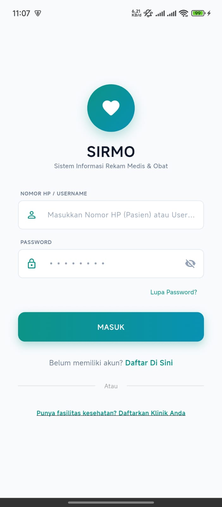
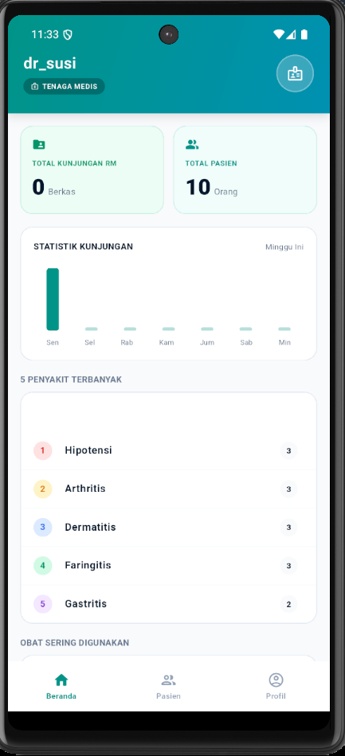
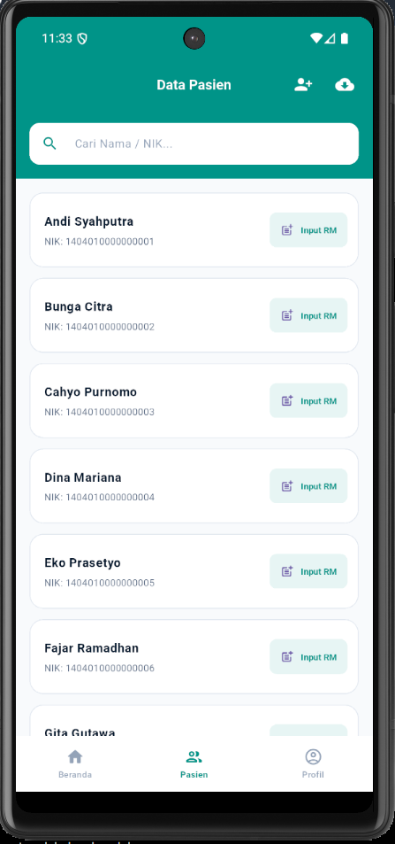
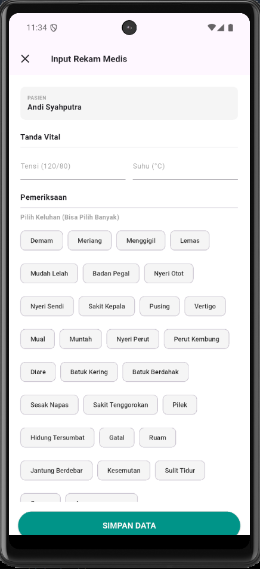
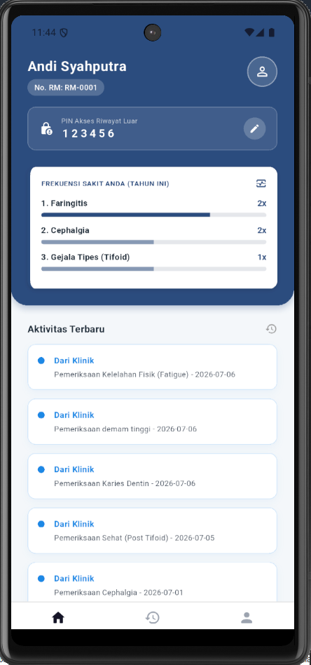
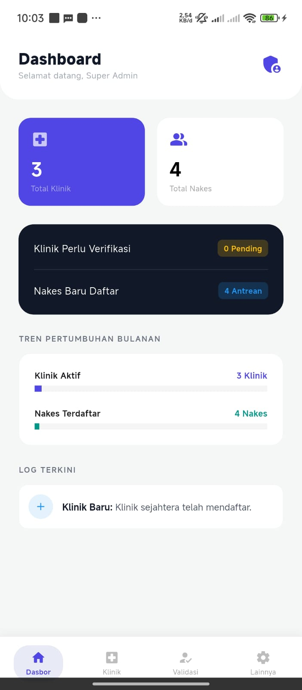

# SIRMO — Medical Records and Medication Information System

SIRMO is an Android-based information system designed to help small outpatient clinics manage patient data, digital medical records, and medication information.

This project was developed as a final-year project for the Diploma III in Informatics Engineering program at Politeknik Negeri Bengkalis.

## Features

- **Authentication:** User login and registration.
- **Patient Management:** Manage and view patient information.
- **Digital Medical Records:** Record patient complaints, diagnoses, vital signs, and medical actions.
- **Medical History:** Access previous medical records and health history.
- **Medication Management:** Manage medication information and records.
- **Medical Certificate:** Generate medical certificates.
- **Patient Dashboard:** Allow patients to view their medical information and health history.
- **Super Admin:** Manage clinic information and validate clinic accounts.

## Screenshots

<table>
  <tr>
    <td align="center" width="50%">
      <strong>Login</strong>  
      
    </td>
    <td align="center" width="50%">
      <strong>Healthcare Worker Dashboard</strong>  
      
    </td>
  </tr>
  <tr>
    <td align="center" width="50%">
      <strong>Patient Management</strong>  
      
    </td>
    <td align="center" width="50%">
      <strong>Medical Record Input</strong>  
      
    </td>
  </tr>
  <tr>
    <td align="center" width="50%">
      <strong>Patient Dashboard</strong>  
      
    </td>
    <td align="center" width="50%">
      <strong>Super Admin Dashboard</strong>  
      
    </td>
  </tr>
</table>

## Tech Stack

- **Mobile Application:** Flutter and Dart
- **Backend:** PHP Native
- **API:** REST API
- **Database:** MySQL
- **UI/UX Design:** Figma

## Development Methodology

This project was developed using the Waterfall methodology, including requirements analysis, system design, implementation, testing, and maintenance planning.

## Testing

According to the final project report:

- **REST API Testing:** 12 endpoints were tested successfully.
- **Black Box Testing:** 17 main features were tested, with a reported 100% success rate.

These results are based on the tests documented in the final project report.

## Project Information

- **Project Name:** Sistem Informasi Rekam Medis dan Obat (SIRMO)
- **Platform:** Android
- **Target Users:** Healthcare workers, patients, and super administrators
- **Developer:** Fitri Rahmatullah Arza
- **Institution:** Politeknik Negeri Bengkalis
- **Program:** Diploma III in Informatics Engineering
- **Year:** 2026

## Project Purpose

SIRMO was developed as an academic final-year project to support the digitalization of medical record management and medication information in small outpatient clinics.

## Notes

This project was developed for academic purposes. Test data used during development and testing were simulated study data, not real patient records.
